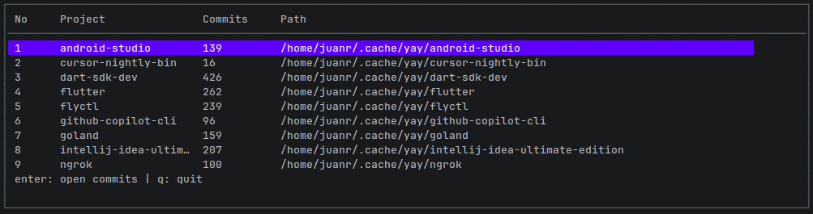
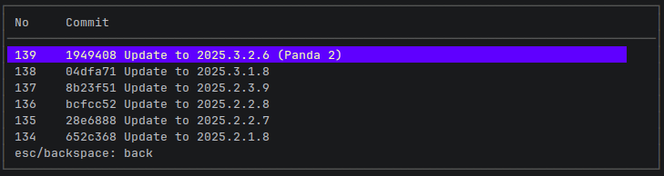

# CTRACKER
Track commits of each project in your local directory

<p align="center">
  
</p>

<p align="center">
  
</p>

### Installation

```bash
go install github.com/juanroy012/ctracker-CLI@latest
```

### Usage
```bash
ctracker
```
User will be prompted to put directory path or you can include it as argument like down below:

```bash
ctracker <path_name>
```


